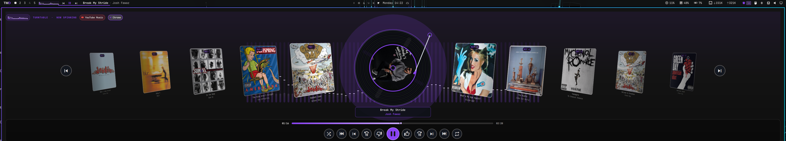

# Turntable Plugin for Omarchy

An interactive **spinning vinyl turntable stage**, **10-track shifting record sleeve carousel**, **real-time PipeWire audio spectrum visualizer**, and **YouTube Music / MPRIS media controller** for the Omarchy top bar, powered by a zero-dependency **native Rust engine**.

### Turntable Stage Overlay


### Top Bar Media Widget


## Features
- **Native Rust Audio & Queue Engine (`src/main.rs`)**: Compiled release binary (`target/release/turntable`) with zero external crate dependencies:
  - **Real-Time 48-Band FFT Spectrum Streamer**: Captures live desktop audio from the default PipeWire / PulseAudio monitor source (`parec`) and streams logarithmically-spaced frequency bands and peak-hold indicators at ~43 FPS.
  - **Persistent Shifting Queue & Artwork Cache**: Queries YouTube Music InnerTube radio queues (`RDAMVM`) and iTunes catalog metadata to populate 5 Previous (`PREV 5..1`) and 5 Up Next (`NEXT +1..+5`) tracks with locally cached high-resolution artwork under `~/.cache/turntable`.
  - **YouTube Music Desktop Actions**: Native support for liking/disliking tracks, toggling shuffle/repeat, seeking ±10 seconds, and jumping directly to the active YouTube Music window.
- **Top Bar Widget**:
  - Live 16-band audio-reactive spectrum visualizer (click to toggle the Turntable overlay).
  - Optically centered transport controls (`Previous`, `Play/Pause`, `Skip`).
  - Smooth continuous scrolling track title and artist marquee.
- **Full-Width Turntable Stage Overlay**:
  - **Center Spinning Vinyl Record**: 60 FPS rotating vinyl grooves, dynamic tonearm, high-resolution circular album label, and crisp native-rendered song title & artist badge.
  - **10-Track Record Sleeve Conveyor Belt**: 5 Previous (`PREV 5..1`) and 5 Next (`NEXT +1..+5`) record sleeves that shift position smoothly along the belt when tracks change, flatten and scale up on hover for easy reading, and jump directly to any sleeve when clicked.
  - **Smooth 60 FPS Seek & Transport Deck**: Interactive progress bar with drag-to-seek and hover preview, plus optically balanced controls for `Shuffle`, `Dislike`, `-10s`, `Previous`, `Play/Pause` (vector icon), `Next`, `+10s`, `Like`, and `Repeat`.

## Dependencies
- **Omarchy / Quickshell** desktop environment
- **Rust toolchain (`cargo`)** to compile the native binary automatically on first load
- **PipeWire / PulseAudio (`parec`)** and **`curl`** for live audio spectrum capture and artwork/queue resolution
- No sudo or pkexec is required.

## Installation

Install with Omarchy's plugin manager:

```bash
omarchy plugin add https://github.com/techmandan/turntable.git --enable
```

On first load, the plugin automatically compiles the local Rust crate (`cargo build --release --manifest-path ~/.config/omarchy/plugins/turntable/Cargo.toml`).

> **Note:** If you still have the built-in `omarchy.media` widget enabled, you can disable it so only `turntable` is shown on the bar:
> ```bash
> omarchy plugin disable omarchy.media
> ```

## Usage
- **Click the spectrum visualizer** on the top bar: Open or close the Turntable stage overlay.
- **Hover any side record sleeve** (`PREV 5..1` / `NEXT +1..+5`): Rotates the sleeve flat and enlarges it to full size with its track & artist pill.
- **Click any side record sleeve**: Animates the conveyor belt and skips directly to that track.
- **Keyboard shortcuts in overlay**:
  - `Space`: Play / Pause
  - `Left` / `Right`: Shift to previous / next track
  - `+` / `=`: Like current track
  - `-` / `_`: Dislike current track
  - `Escape`: Close overlay
- **IPC commands**:
  - `omarchy-shell turntable toggle`
  - `omarchy-shell turntable open`
  - `omarchy-shell turntable close`
  - `omarchy-shell turntable shiftNext`
  - `omarchy-shell turntable shiftPrev`
  - `omarchy-shell turntable like`
  - `omarchy-shell turntable dislike`

## Removal

```bash
omarchy plugin remove turntable
```

## Architecture
- [`src/main.rs`](src/main.rs) & [`Cargo.toml`](Cargo.toml): Zero-dependency native Rust FFT audio spectrum streamer, YouTube Music InnerTube queue resolver, artwork cacher, and YTM controller.
- [`manifest.json`](manifest.json): Omarchy plugin manifest (`schemaVersion: 1`, `kinds: ["service", "bar-widget"]`).
- [`BarWidget.qml`](BarWidget.qml): Top bar media widget and full-width spinning vinyl turntable overlay.
- [`Service.qml`](Service.qml): MPRIS & PipeWire playback stream service and active player selector.
- [`MediaModel.js`](MediaModel.js): Player filtering, metadata helpers, and stream matching utilities.

## License
Released under the [MIT License](LICENSE).
